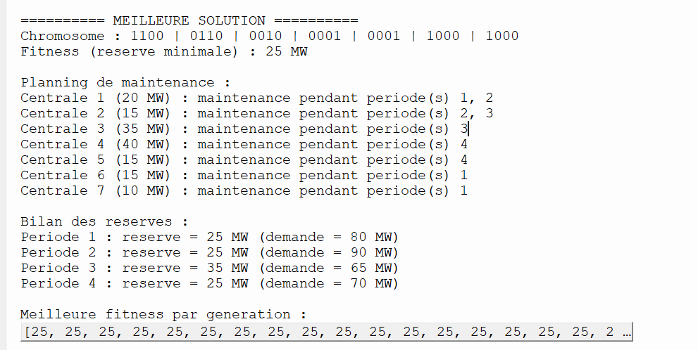

# TP : Ordonnancement des tâches par Algorithme Génétique

## 1. Présentation du problème

Ce travail consiste à résoudre un problème de planification des opérations de maintenance de 7 centrales électriques à l'aide d'un Algorithme Génétique (AG).

L'objectif est de choisir les périodes de maintenance de chaque centrale afin de maximiser la réserve minimale de puissance disponible pendant les 4 périodes de l'année.

## 2. Données du problème

- Nombre de centrales : 7
- Nombre de périodes : 4
- Puissance totale installée : 150 MW

### Puissance des centrales

| Centrale | Puissance (MW) | Nombre de périodes de maintenance |
|---|---:|---:|
| C1 | 20 | 2 |
| C2 | 15 | 2 |
| C3 | 35 | 1 |
| C4 | 40 | 1 |
| C5 | 15 | 1 |
| C6 | 15 | 1 |
| C7 | 10 | 1 |

### Demande en énergie

| Période | Demande (MW) |
|---|---:|
| P1 | 80 |
| P2 | 90 |
| P3 | 65 |
| P4 | 70 |

## 3. Formulation du problème

### Fonction objective

La réserve disponible pour chaque période est calculée par :

**Réserve = Puissance totale - Puissance en maintenance - Demande**

L'objectif est de maximiser la réserve minimale parmi les quatre périodes :

**Maximiser : Z = min(R1, R2, R3, R4)**

Si une réserve est négative, la solution n'est pas acceptable et sa fitness est égale à 0.

### Contraintes

- Les centrales C1 et C2 nécessitent deux périodes consécutives de maintenance.
- Les centrales C3 à C7 nécessitent une seule période de maintenance.
- Chaque centrale doit respecter son nombre de périodes de maintenance.

## 4. Représentation du chromosome

Chaque chromosome contient 7 blocs de 4 bits.

- 1 : la centrale est en maintenance.
- 0 : la centrale fonctionne normalement.

Exemple :

`1100 | 0110 | 0010 | 0001 | 0001 | 1000 | 1000`

Les blocs de C1 et C2 contiennent deux bits 1 consécutifs. Les autres blocs contiennent un seul bit 1.

## 5. Méthodes de l'Algorithme Génétique

### a. Initialisation

La population initiale est générée aléatoirement en respectant les contraintes du problème.

### b. Fonction Fitness

La fitness représente la réserve minimale des quatre périodes.

Une solution avec une réserve négative reçoit une fitness égale à 0.

### c. Sélection par loterie (Roulette Wheel Selection)

La sélection par loterie permet de choisir les parents selon leurs valeurs de fitness.

Une solution avec une meilleure fitness a une probabilité plus élevée d'être sélectionnée.

### d. Croisement (Crossover)

Le croisement est réalisé au niveau des blocs de 4 bits afin de conserver les contraintes de maintenance.

### e. Mutation par inversion

La mutation par inversion consiste à inverser une partie des bits d'un bloc.

La nouvelle combinaison est acceptée seulement si elle respecte les motifs autorisés et les contraintes du problème.

### f. Élitisme

La meilleure solution de chaque génération est conservée pour éviter sa perte.

## 6. Paramètres utilisés

- Taille de la population : 49
- Nombre de générations : 300
- Probabilité de croisement : 0.80
- Probabilité de mutation : 0.01

## 7. Résultat obtenu

La meilleure solution obtenue est :

`1100 | 0110 | 0010 | 0001 | 0001 | 1000 | 1000`

La fitness obtenue est de **25 MW**.

### Réserves obtenues

| Période | Réserve (MW) |
|---|---:|
| P1 | 25 |
| P2 | 25 |
| P3 | 35 |
| P4 | 25 |

La réserve minimale est donc de **25 MW**.

Cette solution respecte les contraintes de maintenance et toutes les réserves sont positives.

## 8. Exécution du programme

Le programme est développé en Python.

Pour l'exécuter, ouvrir le fichier `main.py` avec Python ou Thonny, puis lancer le programme.

## 9. Capture d'écran

### Résultat de l'exécution

       
## 10. Sélection par loterie (Roulette Wheel Selection) – Fichier indépendant

En plus du programme principal, nous avons réalisé un deuxième fichier Python nommé `selection_roulette.py`.

Ce fichier permet d'implémenter et de tester séparément la méthode de sélection par loterie.

### Fonctionnement du code

- La fonction `selection_roulette()` reçoit la population et les valeurs de fitness.
- Elle calcule la somme des fitness.
- Elle génère un nombre aléatoire entre 0 et la somme totale.
- Elle parcourt la population pour déterminer le chromosome sélectionné.
- Les chromosomes ayant une fitness plus élevée ont une probabilité plus importante d'être sélectionnés.
- Si toutes les fitness sont nulles, un chromosome est choisi aléatoirement.

### Exemple de test

Une population de quatre chromosomes est utilisée avec les fitness suivantes :

`[25, 15, 10, 5]`

Le programme exécute la sélection et affiche le chromosome choisi.

### Objectif

L'objectif de ce fichier est de comprendre et de tester indépendamment la méthode Roulette Wheel Selection en Python.

### Capture d'écran

